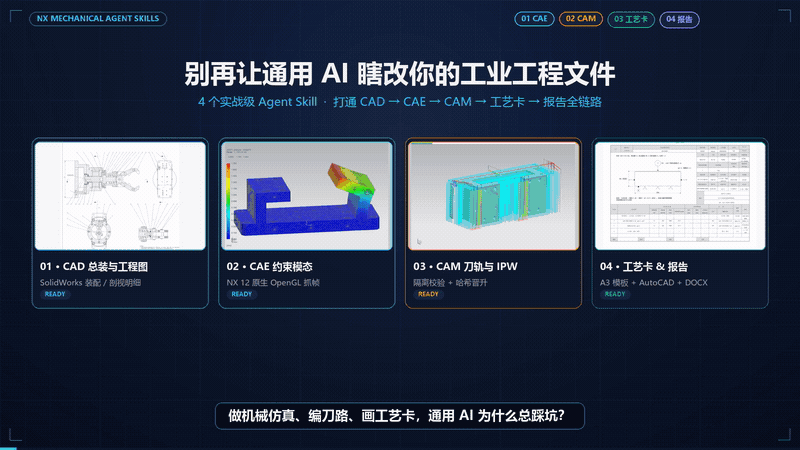
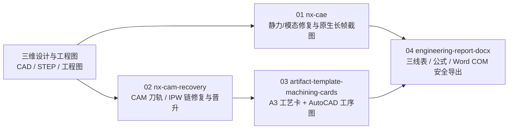

# NX Mechanical Engineering Agent Skills

[](./LICENSE)
[](#一-技能总览)
[](#二-环境依赖与前置条件)

> **让 AI Agent 真正读懂并接管机械工程全流程：从 Siemens NX 有限元/数控刀轨修复，到 AutoCAD 工艺卡片批量制图，再到工科技术报告与 PDF 交付核验。**

[English README](./README_EN.md)

---



---

## 为什么做这套 Skills？

在机械制造课程设计、综合实训及科研仿真中，通用编程助手往往会在真实工业软件面前频频踩坑：
- 新建 **SOL 103 模态方案** 忘记挂载约束，算出 `0.0009 Hz` 刚体噪声，或共用静力输出请求导致单个 `.op2` 暴涨至 `600+ MB`；
- 后台用 `matplotlib` 伪造低质感云图，而不是调用 **NX 12 原生 OpenGL 帧缓冲** 截取标准工程图；
- **NX CAM** 刀轨表面存在缓存路径，独立重开后却弹出未加载组件警告、IPW 断链或坐标系错位；
- 用 `python-docx` 粗暴覆写 `paragraph.text`，瞬间清空工科报告里的可编辑公式（`m:oMath`）与上下标，或遗留僵尸 `WINWORD.EXE` 锁死文件。

本仓库将上述真实工程踩坑与自动化脚本沉淀为 **4 个标准 `SKILL.md` 技能包**，开箱即用，支持 **Antigravity / OpenAI Codex / Claude Code**。

---

## 全流程协作架构



---

## 一、 技能总览

| Skill 名称 | 核心解决的问题 | 内置工具脚本 | 详细入口 |
| :--- | :--- | :--- | :--- |
| **`nx-cae`** | 诊断 NX Nastran 无结果/刚体模态、独立拆分模态输出请求（实测单件 `.op2` 可从 ~610 MB 降至 ~155 MB）、`ResultReference` 路径与单位制绑定、NX 12 原生 OpenGL 后处理云图抓帧、工程体积瘦身边界 | `inspect_cae.py`（无需启动 NX 秒级体检）<br/>`check_sim_nxopen.py`（NXOpen 只读核验） | [SKILL.md](./skills/nx-cae/SKILL.md) |
| **`nx-cam-recovery`** | 修复 CAM 缺失刀轨、工序间 IPW 动态传递与嵌套转塔坐标系变换、T 型槽专用刀具工厂构建、清理无效可视化发生件警告、隔离候选件哈希校验晋升 | 规范工作流与 NX12 API 避坑库 | [SKILL.md](./skills/nx-cam-recovery/SKILL.md) |
| **`artifact-template-machining-cards`** | 复制标准 A3 横向模板生成过程卡/工序卡、核对切削速度/进给/余量公式、调用 AutoCAD 控制台批量绘出带定位夹紧符号的工序图、PDFium 逐页渲染审图 | `sheetgen.py` · `skutil.py`<br/>`inspect_cards.py` · `windows_pdfium.py` | [SKILL.md](./skills/artifact-template-machining-cards/SKILL.md) |
| **`engineering-report-docx`** | 保留模板样式与可编辑公式、统一中西文字体（宋体 / 黑体 / Times New Roman）、标准三线表、章内图表编号查漏与 Word COM 防僵尸进程导出（含 LibreOffice 自动回退） | `check_report_docx.py`<br/>`export_report_pdf.py` | [SKILL.md](./skills/engineering-report-docx/SKILL.md) |

---

## 二、 快速安装（一键部署）

### 方式 1：Windows PowerShell 一键安装

```powershell
git clone https://github.com/Tong-cloud3/nx-mechanical-engineering-skills.git
cd nx-mechanical-engineering-skills

# 同时安装到 Antigravity、Codex、Claude Code（或指定 -Target antigravity / codex / claude）
.\install.ps1 -Target all
```

### 方式 2：macOS / Linux / Git Bash

```bash
git clone https://github.com/Tong-cloud3/nx-mechanical-engineering-skills.git
cd nx-mechanical-engineering-skills
chmod +x install.sh
./install.sh --target all
```

> 安装完成后，新建一个对话即可让 Agent 自动识别并按需加载对应技能。

---

## 三、 命令行体检工具示例

除了指导 AI Agent 的思维与操作边界外，仓库内置脚本也可直接在终端独立运行：

### 1. 秒级体检 NX Nastran CAE 目录（无需打开 NX）

```bash
python skills/nx-cae/scripts/inspect_cae.py /path/to/cae_work_dir
```

输出结构化 JSON，包含：各扩展名体积分布、`.dat` 的求解类型/单位制/`SPC` 卡片数量/`MAT1` 材料抽样/是否误开 `PRINT` 膨胀文本输出、`.f06` 前 N 阶模态频率，以及 `.log` 的 `Analysis complete 0` 状态。

### 2. 体检工科 Word 报告（公式、图表断号与字体核查）

```bash
python skills/engineering-report-docx/scripts/check_report_docx.py /path/to/report.docx
```

自动检测 ZIP 完整性、页面毫米尺寸、`m:oMath` 公式数量、`图X-Y` / `表X-Y` 重号或跳号、遗留占位符（`TODO` / `待补充`）以及中西文字体分布。

### 3. 安全导出报告 PDF（Word COM + LibreOffice 自动回退）

```bash
python skills/engineering-report-docx/scripts/export_report_pdf.py report.docx --out-dir ./pdf_out --update-toc
```

默认以隐藏无弹窗模式调用 Word 刷新目录页码并输出各章所在页码，并在 `finally` 中保证退出进程；若本机未装 Office 或 COM 异常，自动无缝切换至独立隔离 profile 的 LibreOffice 导出。

---

## 四、 环境依赖与前置条件

- **通用体检与排版脚本**：Python 3.10+（推荐安装 `Pillow`，检查 PDF 页数可选 `pypdf`）。
- **CAE/CAM 原生自动化**：Siemens NX 12+（使用 `NXBIN\run_journal.exe` 或 `UGII\ugraf.exe` 图形抓帧）。
- **批量工序图与文档渲染**：AutoCAD Console（`accoreconsole.exe`）、Microsoft Word（Windows COM）或 LibreOffice。
- **标准参考资料**：[standards 目录](./skills/artifact-template-machining-cards/assets/standards/机床夹具设计指导_第三章_定位夹紧符号.pdf) 已随附定位、夹紧符号参考章节（供教学标注与工艺卡制图参考）。

---

## 仓库目录结构

```text
nx-mechanical-engineering-skills/
├── assets/
│   ├── cover-banner.png
│   └── showcase-preview.gif
├── skills/
│   ├── nx-cae/
│   │   ├── SKILL.md
│   │   ├── references/ (solver-checks.md, nx12-automation.md, delivery.md)
│   │   └── scripts/    (inspect_cae.py, check_sim_nxopen.py)
│   ├── nx-cam-recovery/
│   │   ├── SKILL.md
│   │   └── references/ (nx12-repair-patterns.md)
│   ├── artifact-template-machining-cards/
│   │   ├── SKILL.md · artifact-template.json
│   │   ├── assets/     (reference.docx, reference.pdf, preview.png, standards/)
│   │   ├── references/ (engineering.md, drawings.md, windows.md)
│   │   └── scripts/    (sheetgen.py, skutil.py, inspect_cards.py, windows_pdfium.py)
│   └── engineering-report-docx/
│       ├── SKILL.md
│       ├── references/ (word-automation.md)
│       └── scripts/    (check_report_docx.py, export_report_pdf.py)
├── install.ps1 · install.sh
├── LICENSE (MIT)
└── README.md · README_EN.md
```

---

## License

本项目采用 [MIT License](./LICENSE) 开源。欢迎 Fork、二次定制或提交 Issue 交流机械工程 AI 工作流实践。
