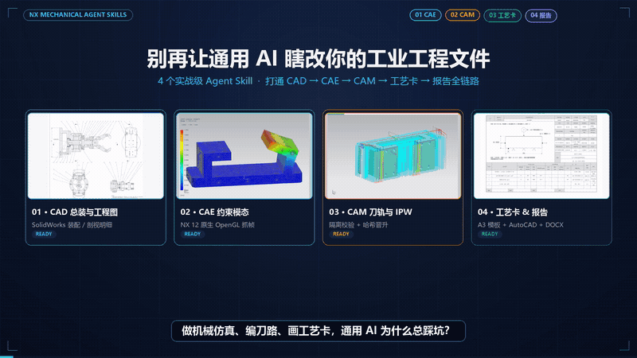

# NX Mechanical Engineering Agent Skills

[](./LICENSE)
[](#skills-overview)
[](#requirements)

> **Practical AI Agent Skills for real-world mechanical engineering workflows: Siemens NX CAE/CAM recovery, AutoCAD process-card sketching, and technical DOCX/PDF delivery.**

[中文说明 (README.md)](./README.md)

---



---

## Skills Overview

| Skill | Capabilities | Bundled Scripts | Entrypoint |
| :--- | :--- | :--- | :--- |
| **`nx-cae`** | Diagnose NX Nastran SOL 101/103 issues (missing constraints / `0 Hz` rigid-body modes), isolate modal output requests (cutting `.op2` size from ~610 MB to ~155 MB), align `ResultReference` paths & units, and capture genuine NX OpenGL post-processing contours | `inspect_cae.py` (offline Nastran audit)<br/>`check_sim_nxopen.py` (read-only NXOpen journal) | [SKILL.md](./skills/nx-cae/SKILL.md) |
| **`nx-cam-recovery`** | Repair NX CAM toolpaths, IPW handoff across setups, coordinate transforms between spindle and milling setups, specialized T-slot tool builders, missing component warnings, and hash-verified candidate promotion | NX 12 repair playbook & API patterns | [SKILL.md](./skills/nx-cam-recovery/SKILL.md) |
| **`artifact-template-machining-cards`** | Populate an unbranded A3 landscape machining process & NC operation card template, validate cutting math ($V_c, f, F$, allowances), generate AutoCAD operation sketches via `accoreconsole`, and inspect pages via PDFium | `sheetgen.py` · `skutil.py`<br/>`inspect_cards.py` · `windows_pdfium.py` | [SKILL.md](./skills/artifact-template-machining-cards/SKILL.md) |
| **`engineering-report-docx`** | Polish and format engineering reports while preserving `m:oMath` equations and subscripts, enforce CJK/Latin fonts & three-line tables, audit figure/table numbering, and safely export PDFs via Word COM or isolated LibreOffice | `check_report_docx.py`<br/>`export_report_pdf.py` | [SKILL.md](./skills/engineering-report-docx/SKILL.md) |

---

## Quick Installation

### Windows (PowerShell)

```powershell
git clone https://github.com/Tong-cloud3/nx-mechanical-engineering-skills.git
cd nx-mechanical-engineering-skills
.\install.ps1 -Target all   # or: antigravity | codex | claude
```

### macOS / Linux

```bash
git clone https://github.com/Tong-cloud3/nx-mechanical-engineering-skills.git
cd nx-mechanical-engineering-skills
chmod +x install.sh
./install.sh --target all   # or: antigravity | codex | claude
```

---

## Standalone CLI Utilities

```bash
# 1. Inspect an NX Nastran CAE directory without launching NX
python skills/nx-cae/scripts/inspect_cae.py /path/to/cae_dir

# 2. Audit a technical report DOCX (ZIP integrity, equations, caption sequence, fonts)
python skills/engineering-report-docx/scripts/check_report_docx.py /path/to/report.docx

# 3. Safely export DOCX to PDF (Word COM with TOC refresh + automatic LibreOffice fallback)
python skills/engineering-report-docx/scripts/export_report_pdf.py report.docx --out-dir ./pdf_out --update-toc
```

---

## Requirements

- **Python 3.10+** (`Pillow` for image/PDFium rendering; `pypdf` optional for PDF page-size audit).
- **Siemens NX 12+** (optional, required only for `check_sim_nxopen.py` and native NX OpenGL automation).
- **AutoCAD (`accoreconsole.exe`)**, **Microsoft Word** (Windows COM), or **LibreOffice** for CAD sketching and PDF export.
- **Included Reference**: `skills/artifact-template-machining-cards/assets/standards/机床夹具设计指导_第三章_定位夹紧符号.pdf` is bundled as a locating/clamping symbol reference for process-card drafting.

## License

Released under the [MIT License](./LICENSE).
