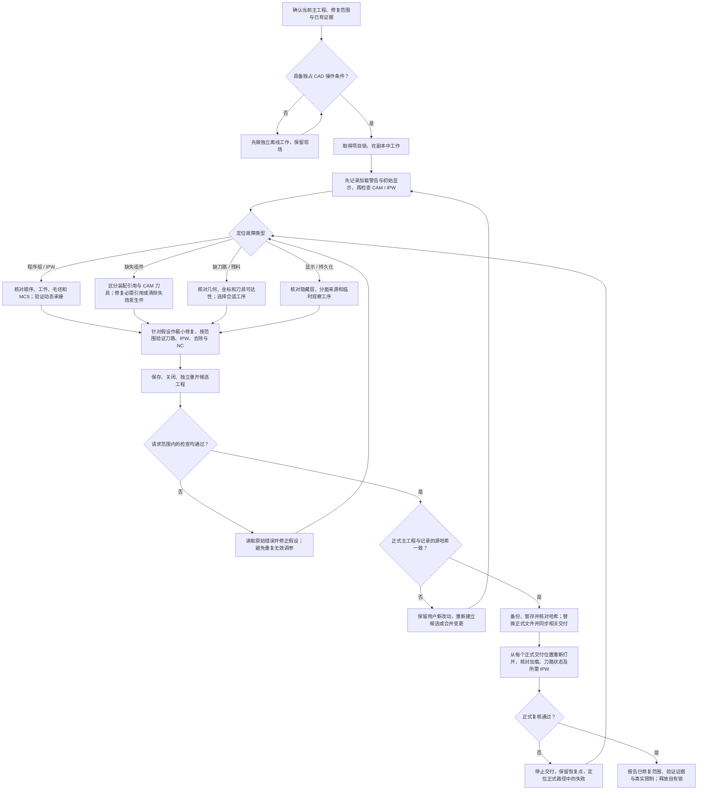

# NX CAM Recovery

Use for an existing CAM part with missing/incorrect paths, stale or broken IPW, unwanted stock display, component load warnings, or save/reopen failures. Use the installed NX API and local documentation; API names and behavior can differ by version.

## Recovery workflow

1. Identify the current master, authorized change, source CAD, operation order, and latest evidence. Check the project lock and live CAD sessions before opening or editing. Keep the user's source geometry and drawings unchanged; test on a copy.
2. Capture initial load status and display **before** CAM initialization or IPW inspection. Preserve every unloaded-part name and status description from `PartLoadStatus` before disposing it.
3. Form a specific hypothesis, make the smallest relevant change, and check the affected behavior. Use the modes below. Stop repeating parameter trials that produce the same failure; inspect the geometry, API contract, or raw error before choosing another approach. Continue other authorized work when a specific dependency is blocked.
4. Save and reopen independently. Check component loading, operation/path status, initial display, and requested IPW behavior. Neither a nonzero cached path nor a successful API/launcher return proves material removal or persistence.
5. Promote only a candidate that passes the requested checks: back up the current master, confirm it has not changed since the candidate was made, stage and hash-check the replacement, then reopen the actual formal path. Synchronize affected NC, delivery copies, entrypoints and manifests; do not overwrite unrelated changes.
6. Report the repaired scope, actual checks, and remaining limitations. A completed diagnostic round is not a completed repair. Distinguish cached paths, native computation, material-removal simulation, postprocessing, and real machine validation.

## 流程图

各分支按本次请求选用；验证项目随改动范围确定。若缺少必要输入或外部条件，记录具体阻碍并继续可独立完成的已授权工作，不把阶段排查当作修复完成。

## Choose the relevant mode

- **Program groups / automatic IPW:** A program folder controls order; workpiece, blank and MCS associations control stock handoff. Trace both trees. Verify native updating with a reversible upstream-order change in a separate copy, restore the order, and verify again after reopen. A frozen stage solid/facet is a snapshot, even when embedded in the same PRT; do not describe it as a dynamic link.
- **Missing component warnings:** Inspect both assembly occurrences and CAM tool definitions. Remove a stale visualization occurrence only after establishing its role; preserve/rebuild required geometry and references. Compare active tool parameters and paths before/after, and require no unresolved load warnings in each formal delivery location. Do not hide the warning by weakening load options. See the component section in the reference.
- **Wrong or incomplete cuts:** Inspect motion endpoints including arcs, source geometry, stock coordinates and accessibility. Validate actual output IPW against both the material to remove and the material to retain. If another machining method is needed, respect the user's chosen scope; distinguish ordinary milling from undercut-capable tooling.
- **Wrong initial display:** Account for blank state **and layer visibility**. `GetInputIpw()` can create/reveal diagnostic facets. Record their provenance and avoid persisting temporary observer operations. Do not delete a facet body that supplies a real blank.

## References

- Read [NX12 repair patterns](references/nx12-repair-patterns.md) for coordinate persistence, specialized tool builders, T-slot access, load-status collection, and evidence examples.
